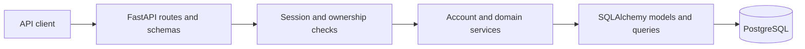

# Backend architecture

This guide describes the implemented backend and the boundaries used when
extending it. Start with the [backend README](../README.md) for setup. Use the
[V1 specification](domain-v1.md) for domain requirements and the
[domain ER diagram](huntly-v1-er-diagram.md) for its relationship overview; those
references include intended behavior beyond the current API.

## Runtime and application structure

The backend is one FastAPI application backed by PostgreSQL. Uvicorn serves the
application defined in [app/main.py](../app/main.py). The development Docker
command applies migrations before starting Uvicorn with reload enabled.
Dependencies are declared in [pyproject.toml](../pyproject.toml) and resolved in
[uv.lock](../uv.lock). The project uses Python 3.14 and PostgreSQL 18 in its
container and CI workflows.

| Location | Responsibility |
| --- | --- |
| [app/main.py](../app/main.py) | Router registration, credentialed CORS, validation-error redaction, private-response cache headers |
| [app/api/](../app/api/) | HTTP inputs, authentication/ownership checks, response codes, transaction boundaries |
| [app/schemas/](../app/schemas/) | Pydantic request validation and explicit public response fields |
| [app/services/](../app/services/) | Account/domain operations and database queries using the supplied session |
| [app/services/exceptions/](../app/services/exceptions/) | Domain-service errors translated to HTTP responses by resource routes |
| [app/models/](../app/models/) | SQLAlchemy tables, relationships, normalization hooks, database constraints |
| [app/core/database.py](../app/core/database.py) | Engine, session factory, declarative base, request-session dependency |
| [app/core/config.py](../app/core/config.py) | Environment and `.env` settings |
| [app/core/auth.py](../app/core/auth.py), [security.py](../app/core/security.py) | Session identity, browser-write checks, password and token helpers |
| [alembic/](../alembic/) | Versioned schema changes and model-metadata discovery |
| [tests/](../tests/) | Schema, model, service, HTTP, configuration, and migration verification |

The main dependency direction is:

Authentication and ownership checks can also query PostgreSQL. This diagram
shows responsibility boundaries rather than a strict call sequence. Read
schemas select the fields returned to clients, including when routes return ORM
objects directly.

## Follow a request: create a company

`POST /companies/` is a compact example spanning the layers:

1. FastAPI validates the body as
   [CompanyCreateRequest](../app/schemas/resource_requests.py).
2. [get_current_user](../app/core/auth.py) resolves the cookie through
   [AuthSessionService](../app/services/auth_session.py). It rejects missing or
   expired sessions and checks the CSRF header and browser origin for writes.
   Its lookup transaction finishes before the route begins its own transaction.
3. The [company route](../app/api/company.py) rejects a conflicting supplied
   `user_id` and builds the internal `CompanyCreate` input using the signed-in
   user's ID.
4. Inside `db.begin()`, [CompanyService](../app/services/company.py) checks the
   owner and known duplicates, adds a `Company`, and flushes the write. The
   [model](../app/models/company.py) maintains the normalized name; PostgreSQL
   enforces uniqueness on `(user_id, normalized_name)`.
5. A successful transaction commits. FastAPI serializes the result through
   [CompanyRead](../app/schemas/company.py) and returns 201. Errors raised inside
   the transaction cause rollback.

For detail reads, updates, and deletes, the route first uses an owner-scoped
lookup. A foreign record and an absent record both produce 404. A client-supplied
UUID never substitutes for an ownership check.

## Database sessions and transactions

A **database session** is the SQLAlchemy object used to talk to PostgreSQL. A
**login session** is a stored `AuthSession` row identifying a signed-in browser.
They have different lifetimes and purposes.

[get_db](../app/core/database.py) supplies an `AsyncSession` for a request and
closes it afterward. Closing rolls back pending work. The configured factory
uses `autoflush=False` and `expire_on_commit=False`.

- Routes own `async with db.begin()` scopes and therefore own commits and rollback.
- Services query, add, delete, refresh, or flush records without committing.
- `flush()` sends pending changes to PostgreSQL within the current transaction;
  the caller's later commit makes them durable.
- Role/event creation and status-history writes share one transaction.
- Authentication finishes its initial lookup transaction before the handler's
  transaction. This avoids opening `db.begin()` while a lookup has already
  started a transaction on the same session.
- Login cookies are set only after session creation commits. Cookie clearing
  follows successful revocation or profile deletion.

Scalar ORM fields remain available after commit because
`expire_on_commit=False`. Relationships still need deliberate eager loading when
accessed during async response serialization or after the session closes. Read
schemas generally avoid nested ownership collections.

## Authentication and authorization

The auth implementation separates four concerns:

| Component | Role |
| --- | --- |
| [AuthService](../app/services/auth.py) | Registration, credential checks, password changes, coordinated logout across devices |
| [AuthSessionService](../app/services/auth_session.py) | Session creation, token lookup, expiry filtering, and revocation |
| [Request dependencies](../app/core/auth.py) | Resolve the stored user identity; enforce Origin and CSRF rules |
| [Response helpers](../app/api/auth_responses.py) | Public account/session responses and cookie settings |

Passwords use salted Argon2id hashes. A random login token is sent in an HttpOnly
cookie, while only its digest is stored in PostgreSQL. A separate CSRF token is
returned to the client for authenticated writes. Password hashing and checking
run in helper threads so the API can continue handling other requests while
those synchronous operations finish.

Routes enforce access to the signed-in user's resources. Some internal service
methods accept explicit owner IDs or retrieve by ID without authorization; they
are not a replacement for the HTTP ownership boundary. A new route must apply
that boundary before calling them. Company links on roles and contacts must
also stay within the same owner.

For full endpoint, cookie, CSRF, frontend, and error contracts, see
[Authentication and sessions](authentication.md).

## Data model and domain behavior

The current model registry contains nine tables:

| Table | Meaning and ownership |
| --- | --- |
| `users` | Display name and optional paired login credentials for legacy compatibility |
| `auth_sessions` | Revocable login records belonging to a user |
| `companies` | User-owned organizations with owner-scoped normalized names |
| `contacts` | User-owned people, optionally linked to a company |
| `tracked_roles` | User-owned opportunities, optionally linked to a company |
| `tracked_role_events` | Dated activities owned through their parent role |
| `status_history` | Initial and subsequent role-status transitions |
| `event_status_histories` | Initial and subsequent event-status transitions |
| `tracked_role_contact_associations` | Role/contact relationship records |

[app/models/__init__.py](../app/models/__init__.py) imports every mapped model so
Alembic can discover the complete schema. Python compatibility aliases such as
`Event` and `TrackedRoleStatusHistory` do not create additional tables.

Important implemented rules:

- Company display names collapse whitespace; their duplicate keys use Unicode
  case folding. Uniqueness is scoped to the owner.
- Role and event statuses are required explicitly. Enum values on the wire are
  lowercase, such as `saved` and `scheduled`; see [enums.py](../app/enums.py).
- Creation records an initial status-history row. Updating to a different status
  appends a transition; assigning the existing status does not add one.
- `occurred_at` records an effective transition time. `created_at` records when
  the row was stored. Event dates/times describe the scheduled activity.
- PATCH services use `exclude_unset=True`: omitted fields remain unchanged;
  explicit null clears nullable fields. Required fields have resource-specific
  null validation, and services check merged values where necessary.
- Deleting a company clears company links on roles and contacts. Deleting a role
  removes dependent events, histories, and contact associations. Independent
  companies and contacts remain.
- Profile deletion currently requires the user to have no owned domain records.
  Successful deletion also removes their login sessions.

The domain documents also specify broader workflows. The current API has CRUD
routes for companies, contacts, roles, and events, plus account/profile endpoints.
It has no dedicated history-management or role-contact association endpoints,
no similar-role duplicate-warning workflow, and no combined create-company-and-
role operation. Existing company IDs are linked through the separate CRUD APIs.
Do not infer feature completion solely from the presence of a model or a domain
requirement.

## Configuration, errors, and concurrency

Settings are loaded when the application modules are imported. Environment
variables override `.env`; missing `DATABASE_URL` or `ALLOWED_ORIGINS` prevents
startup. Compose overrides the database URL to use its internal service names.
See [development configuration](../README.md#connection-and-configuration-reference)
and [auth settings](authentication.md) for browser and cookie settings.

Resource routes translate known domain errors into HTTP responses; unexpected
storage errors generally become 500. `AuthService` currently raises HTTP errors
directly for credential/session failures. FastAPI input validation returns 422
with locations and messages, while submitted values are omitted to avoid
reflecting passwords. The application adds `Cache-Control: no-store` to private
responses and enables credentialed CORS for explicit allowed origins.

Password changes lock and reload the user, then recheck that the requesting
session is active. Login and logout-all use the same user-row lock to coordinate
with that work. Ordinary domain status updates do not define a concurrent-edit
conflict policy. A concurrent company insert/rename can still hit the database
unique constraint after its service-level duplicate check and surface as 500;
that database safeguard does not guarantee the same friendly error as a known
duplicate.

## Change a backend feature

1. Find the route and request/read schemas for the behavior.
2. Check the domain requirements and the current service implementation.
3. Update input validation, owner checks, service behavior, and response fields
   where the change belongs. Keep transaction ownership at the route.
4. For schema changes, import new models into the registry and follow the
   [migration workflow](alembic-guide.md).
5. Add the corresponding schema/service/API/database tests with the change.
   Check persistence and rollback through a fresh database session where relevant.
6. Use the [testing guide](../tests/README.md) for focused checks, then the full suite.

The current deployment scope and missing account features are listed in the
[authentication guide](authentication.md#current-scope). Development Docker
configuration includes reload and is not a production deployment definition.
